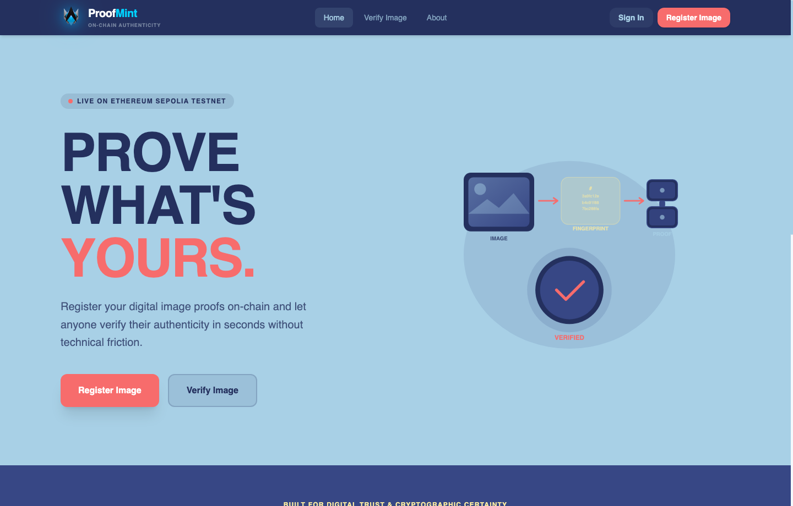
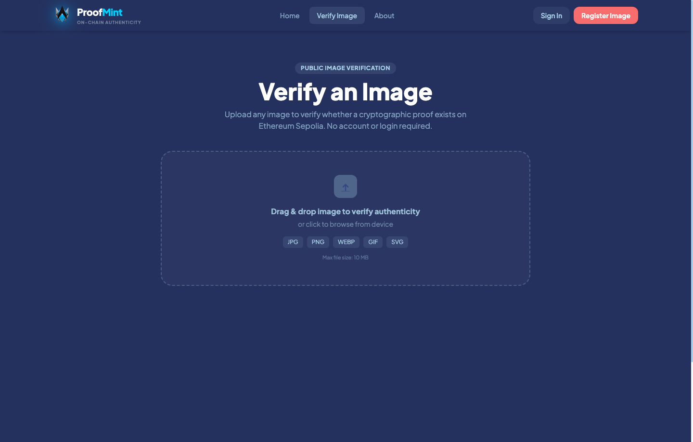
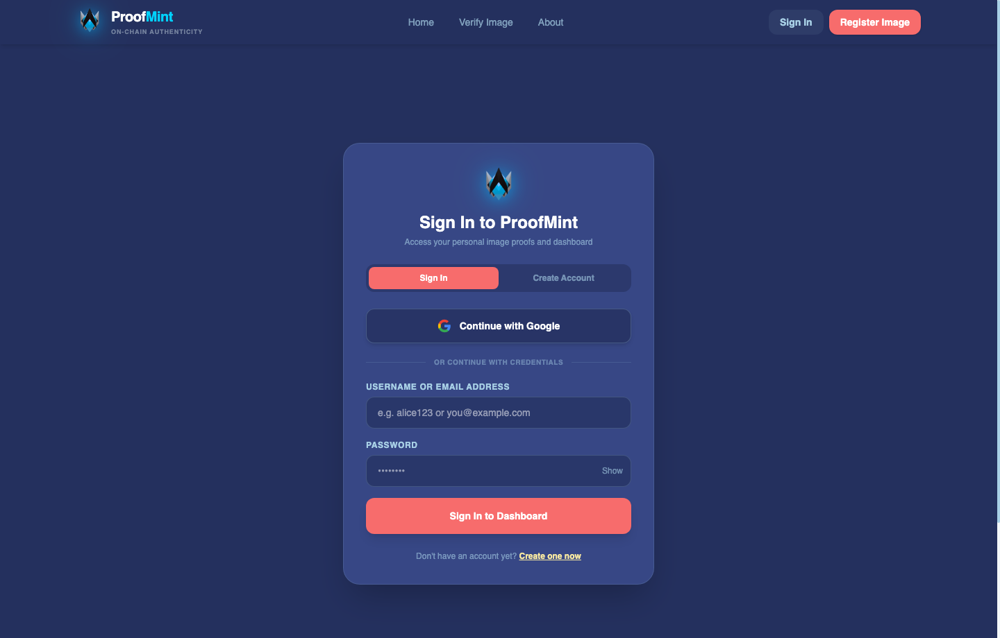
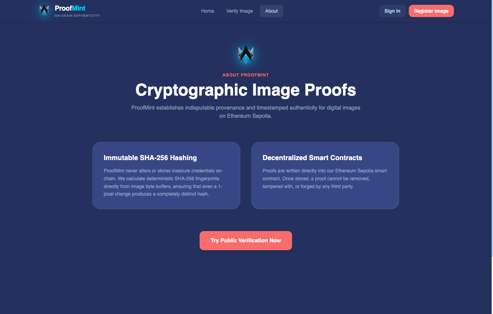
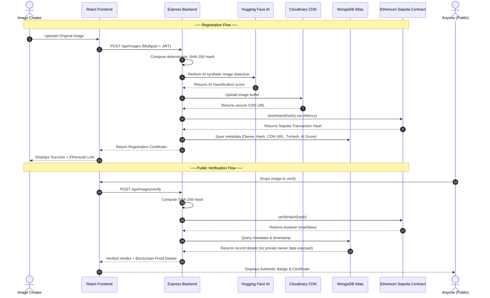

<p align="center">
  
</p>

<h1 align="center">ProofMint</h1>

<p align="center">
  <strong>Decentralized Digital Image Provenance & Authenticity Verification Platform</strong><br />
  Powered by Cryptographic SHA-256 Hashing, AI Media Analysis, and Ethereum Sepolia Blockchain
</p>

<p align="center">
  <a href="https://proof-mint-mu.vercel.app" target="_blank">
    
  </a>
  <a href="https://sepolia.etherscan.io/address/0x3E73D50b6591Dd8626eE32ebC367bBDe03E88685" target="_blank">
    
  </a>
  <a href="https://proofmint-pwcy.onrender.com" target="_blank">
    
  </a>
</p>

<p align="center">
  
  
  
  
  
  
  
  
  
  
  
</p>

---

## 🌐 Website & Frontend Showcase

ProofMint provides a streamlined, accessible Web3 experience built with **React 19**, **TypeScript**, and **Tailwind CSS v4**. It is engineered to bridge decentralized trust with zero-friction user onboarding.

### 🚀 Landing Page & Interactive Hero
The ProofMint landing page welcomes creators, journalists, and verifiers with clear real-time network status, cryptographic explanations, and single-click access to both public verification and creator registration.

<p align="center">
  
</p>

---

### 🔍 Instant Public Image Verification
*No login, wallet, or MetaMask required.* Anyone can drag and drop an image to compute its SHA-256 cryptographic fingerprint client-side and verify its authenticity against the Ethereum Sepolia smart contract in real time.

<p align="center">
  
</p>

- **Instant Hash Computation**: Deterministic SHA-256 fingerprint generated directly from the raw image byte buffer.
- **On-Chain Confirmation**: Queries the smart contract for verifiable immutability.
- **Authenticity Verdict**: Returns a cryptographically verified badge, registration timestamp, and direct transaction link to Sepolia Etherscan.

---

### 🔐 Frictionless Authentication & Security
ProofMint supports standard credentials alongside **Google OAuth 2.0** for one-click creator registration, complete with JWT session management and protected dashboards.

<p align="center">
  
</p>

---

### 🛡️ Cryptographic Architecture & Provenance
Transparent documentation of ProofMint's underlying cryptographic guarantees, illustrating how even a 1-pixel alteration completely mutates the SHA-256 digest, preventing unauthorized tampering or forgery.

<p align="center">
  
</p>

---

## 🎯 The Problem

In an era of generative AI, deepfakes, and rampant media redistribution, proving that a digital image is authentic and unaltered is nearly impossible:
- **Metadata is Fragile**: EXIF tags and file creation dates are effortlessly stripped or forged by social media platforms and photo editors.
- **Deepfakes & AI Images**: Synthetic media spreads unchecked without verifiable origin or creator attribution.
- **Copyright Theft**: Artists, photographers, and journalists lose attribution when their work is replicated or claimed by others.

---

## 💡 The ProofMint Solution

ProofMint solves this dilemma through **cryptographic fingerprints and immutable blockchain consensus**:

1. **Deterministic Fingerprinting**: Rather than attempting to store massive media files on-chain (which is cost-prohibitive and slow), ProofMint calculates the image's unique **SHA-256 cryptographic hash**.
2. **Immutable Blockchain Anchoring**: The 256-bit hash is permanently registered in our Solidity smart contract on the **Ethereum Sepolia testnet**.
3. **Decentralized Media Storage**: The high-resolution image is hosted on **Cloudinary**, while its metadata is indexed in **MongoDB Atlas**.
4. **AI Provenance Analysis**: During registration, media is analyzed with **Hugging Face AI** inference models to classify synthetic vs authentic media.
5. **Zero-Friction Public Verification**: Anyone holding an image file can test its authenticity against the blockchain without creating an account or paying gas.

---

## 🔄 End-to-End Architecture



---

## ✨ Key Features

- 🛡️ **Zero-Friction Public Verification**: Anyone can verify an image instantly from any device without a wallet or account.
- ⛓️ **Ethereum Sepolia Blockchain**: All proofs are permanently written into a verified smart contract.
- ⚡ **Gasless Creator Experience**: Automated server-relayed minting ensures creators don't need Sepolia ETH in their personal wallet to mint proofs.
- 🤖 **AI Content Detection**: Integrated Hugging Face machine learning models analyze images for generative AI markers.
- ☁️ **High-Performance Hybrid Storage**: High-resolution image assets are served instantly via Cloudinary CDN, while the immutable cryptographic fingerprint remains on-chain.
- 🔑 **Multi-Factor Authentication**: Supports password authentication and Google One-Tap / OAuth 2.0.
- 📱 **Fully Responsive UI**: Mobile-optimized, dark-navy theme crafted with Tailwind CSS v4 and fluid animations.

---

## 📜 Smart Contract Specification

The core contract is deployed on **Ethereum Sepolia** and verified on Etherscan:

- **Network**: Ethereum Sepolia Testnet
- **Contract Address**: [`0x3E73D50b6591Dd8626eE32ebC367bBDe03E88685`](https://sepolia.etherscan.io/address/0x3E73D50b6591Dd8626eE32ebC367bBDe03E88685)
- **Solidity Version**: `^0.8.28`

```solidity
// SPDX-License-Identifier: MIT
pragma solidity ^0.8.28;

contract ProofMint {
    // Mapping of SHA-256 hash string => boolean existence
    mapping(string => bool) public hashes;

    // Registers a new cryptographic image hash on-chain
    function storeHash(string memory hash) public {
        require(!hashes[hash], "Hash already exists");
        hashes[hash] = true;
    }

    // Public view function to verify whether a hash is registered
    function verifyHash(string memory hash) public view returns (bool) {
        return hashes[hash];
    }
}
```

---

## 🛠️ Technology Stack

| Layer | Technologies |
| :--- | :--- |
| **Frontend** | React 19, TypeScript, Vite, Tailwind CSS v4, Plus Jakarta Sans, JetBrains Mono |
| **Backend** | Node.js, Express.js, Multer (Memory Storage), Mongoose, Axios, Streamifier, CORS |
| **Blockchain** | Solidity (`^0.8.28`), Hardhat 3, Ethers.js v6, Ethereum Sepolia Testnet, Alchemy RPC |
| **Cloud & Media** | Cloudinary CDN (Asset Delivery), MongoDB Atlas (Document Database) |
| **AI & Auth** | Hugging Face Inference API, Google Identity Services (OAuth 2.0), JWT |
| **Deployment** | Vercel (Frontend SPA), Render (Express Backend API) |

---

## 📡 API Reference

### Base URLs
- **Production API**: `https://proofmint-pwcy.onrender.com`
- **Local API**: `http://localhost:3001`

### Endpoints

| Method | Endpoint | Auth Required | Description |
| :--- | :--- | :---: | :--- |
| `POST` | `/api/images/verify` | ❌ No | **Public verification**: Uploads an image, computes its SHA-256 hash, and queries Ethereum Sepolia. |
| `POST` | `/api/images` | ✅ Yes | **Register image**: Computes hash, uploads to Cloudinary, executes `storeHash` on Sepolia, and saves metadata. |
| `GET` | `/api/images` | ✅ Yes | Returns all registered proofs owned by the authenticated user. |
| `POST` | `/api/auth/register` | ❌ No | Create a new user account (`username`, `email`, `password`). |
| `POST` | `/api/auth/login` | ❌ No | Login with username/email and password. Returns JWT token. |
| `POST` | `/api/auth/google` | ❌ No | Authenticate via Google OAuth Credential or ID Token. |
| `GET` | `/api/auth/me` | ✅ Yes | Fetch authenticated user profile and stats. |

#### Example: Public Verification Response (`POST /api/images/verify`)
```json
{
  "success": true,
  "authentic": true,
  "status": "verified",
  "title": "✓ Verified",
  "message": "This image matches a registered ProofMint proof.",
  "imageHash": "7f83b1657ff1fc53b92dc18148a1d65dfc2d4b1fa3d677284addd200126d9069",
  "proofDetails": {
    "blockchain": "Ethereum Sepolia Testnet",
    "txHash": "0x4a7f23c91d74659b8543f07a755d5b78b024483a92b23a73c1d932e6fb154942",
    "uploadedAt": "2026-03-12T14:20:00.000Z",
    "fileName": "original_artwork.png",
    "fileSize": 2048592,
    "imageUrl": "https://res.cloudinary.com/..."
  },
  "note": "Cryptographic proof confirmed on-chain."
}
```

---

## 📂 Project Structure

```text
ProofMint/
├── frontend/                     # React 19 + TypeScript + Vite Client
│   ├── public/                   # Favicon and static assets
│   ├── src/
│   │   ├── components/           # Reusable UI components & SVG logos
│   │   ├── context/              # Authentication context (Google + JWT)
│   │   ├── services/             # API clients & backend connectors
│   │   ├── App.tsx               # Primary page routes & dashboard views
│   │   ├── main.tsx              # Application entry point
│   │   └── index.css             # Tailwind v4 theme & keyframe animations
│   ├── package.json
│   └── vite.config.ts
│
├── backend/                      # Node.js + Express REST API
│   ├── src/
│   │   ├── config/               # Cloudinary, Multer, and MongoDB setup
│   │   ├── contracts/            # Smart contract ABI artifacts
│   │   ├── controllers/          # Auth, Image registration & verification
│   │   ├── middlewares/          # JWT bearer token verification
│   │   ├── models/               # Mongoose schemas (User, Image)
│   │   ├── routes/               # API route definitions
│   │   ├── services/             # Sepolia blockchain service (ethers.js)
│   │   └── server.js             # HTTP server entrypoint
│   └── package.json
│
├── blockchain/                   # Hardhat 3 Ethereum Workspace
│   ├── contracts/
│   │   └── ProofMint.sol         # Solidity smart contract
│   ├── ignition/                 # Deployment modules
│   ├── hardhat.config.ts         # Hardhat & Sepolia network configuration
│   └── package.json
│
├── screenshots/                  # High-resolution frontend previews
└── README.md                     # Project documentation
```

---

## 🚀 Getting Started

### Prerequisites
- [Node.js](https://nodejs.org/) (v20.x or higher recommended)
- [npm](https://www.npmjs.com/) or [pnpm](https://pnpm.io/)
- [Git](https://git-scm.com/)
- [MetaMask](https://metamask.io/) or an Ethereum Sepolia RPC URL (Alchemy / Infura)
- Free accounts for [MongoDB Atlas](https://www.mongodb.com/atlas), [Cloudinary](https://cloudinary.com/), and [Hugging Face](https://huggingface.co/)

---

### 1. Clone the Repository
```bash
git clone https://github.com/arpitraj1720/ProofMint.git
cd ProofMint
```

---

### 2. Backend Setup
```bash
cd backend
npm install
```

Create a `.env` file in the `backend/` directory:
```env
PORT=3001
MONGODB_URI=mongodb+srv://<username>:<password>@cluster.mongodb.net/proofmint
JWT_SECRET=your_jwt_super_secret_key
CLOUDINARY_CLOUD_NAME=your_cloudinary_name
CLOUDINARY_API_KEY=your_cloudinary_key
CLOUDINARY_API_SECRET=your_cloudinary_secret
HUGGINGFACE_API_KEY=your_huggingface_key
BLOCKCHAIN_RPC_URL=https://eth-sepolia.g.alchemy.com/v2/your_alchemy_key
PROOFMINT_CONTRACT_ADDRESS=0x3E73D50b6591Dd8626eE32ebC367bBDe03E88685
BLOCKCHAIN_PRIVATE_KEY=your_sepolia_wallet_private_key
FRONTEND_URL=http://localhost:5173
GOOGLE_CLIENT_ID=your_google_oauth_client_id
```

Start the backend development server:
```bash
npm run dev
# Backend runs at http://localhost:3001
```

---

### 3. Smart Contract Deployment (Optional)
If you want to deploy a fresh instance of the contract to Sepolia:
```bash
cd ../blockchain
npm install
npx hardhat compile
npx hardhat ignition deploy --network sepolia ignition/modules/ProofMint.ts
```

---

### 4. Frontend Setup
```bash
cd ../frontend
npm install
```

Create a `.env` file in the `frontend/` directory:
```env
VITE_API_BASE_URL=http://localhost:3001
VITE_GOOGLE_CLIENT_ID=your_google_oauth_client_id
```

Launch the frontend client:
```bash
npm run dev
# Frontend runs at http://localhost:5173
```

Open [http://localhost:5173](http://localhost:5173) in your browser to experience ProofMint.

---

## ⚙️ Environment Variables Reference

### Backend (`backend/.env`)
| Variable | Description |
| :--- | :--- |
| `PORT` | Local server port (Default: `3001`) |
| `MONGODB_URI` | MongoDB Atlas connection string |
| `JWT_SECRET` | Secret key for signing and verifying JWT tokens |
| `CLOUDINARY_CLOUD_NAME` | Cloudinary cloud identifier |
| `CLOUDINARY_API_KEY` | Cloudinary API key |
| `CLOUDINARY_API_SECRET` | Cloudinary API secret |
| `HUGGINGFACE_API_KEY` | Hugging Face inference token for AI media detection |
| `BLOCKCHAIN_RPC_URL` | Sepolia testnet RPC URL (e.g. Alchemy or Infura) |
| `PROOFMINT_CONTRACT_ADDRESS` | Deployed address of `ProofMint.sol` |
| `BLOCKCHAIN_PRIVATE_KEY` | Relayer private key for sponsoring gasless mints |
| `FRONTEND_URL` | Allowed CORS origin (e.g. `http://localhost:5173` or Vercel URL) |
| `GOOGLE_CLIENT_ID` | Google OAuth 2.0 Web Client ID |

### Frontend (`frontend/.env`)
| Variable | Description |
| :--- | :--- |
| `VITE_API_BASE_URL` | Backend server URL (`http://localhost:3001` or Render URL) |
| `VITE_GOOGLE_CLIENT_ID` | Google OAuth Client ID for One-Tap / Identity Services |

---

## 🗺️ Roadmap

- [x] Client & server-side SHA-256 cryptographic hashing
- [x] Solidity smart contract deployment to Ethereum Sepolia
- [x] Public verification interface (Zero-login verification)
- [x] Cloudinary CDN image offloading
- [x] Google OAuth 2.0 & JWT authentication
- [x] AI-generated image analysis integration
- [ ] IPFS / Arweave decentralized image hosting
- [ ] Layer-2 deployment (Polygon, Arbitrum, Base) for lower gas fees
- [ ] C2PA Content Credentials metadata compliance
- [ ] Imperceptible cryptographic watermark stamping on downloaded media

---

## 📄 License

This project is licensed under the [MIT License](LICENSE).

---

<p align="center">
  Built with ❤️ for digital trust, creator provenance, and verifiable truth on the blockchain.
</p>