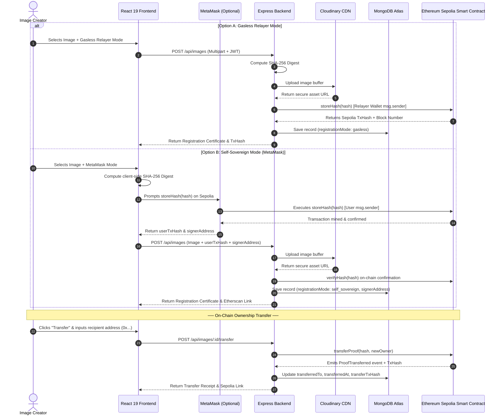

<p align="center">
  
</p>

<h1 align="center">ProofMint</h1>

<p align="center">
  <strong>Decentralized Digital Image Provenance & Authenticity Verification Platform</strong><br />
  Powered by Cryptographic SHA-256 Hashing, AI Media Analysis, and Ethereum Sepolia Smart Contracts
</p>

<p align="center">
  <a href="https://proof-mint-mu.vercel.app" target="_blank">
    
  </a>
  <a href="https://sepolia.etherscan.io/address/0x55fe6BEC3C241840FF337E5CB323671Fe7265cEF" target="_blank">
    
  </a>
  <a href="https://proofmint-pwcy.onrender.com" target="_blank">
    
  </a>
</p>

<p align="center">
  
  
  
  
  
  
  
  
  
  
  
</p>

---

## Academic Attribution & Team

ProofMint is developed as a decentralized blockchain engineering project by students of **Vellore Institute of Technology (VIT), Chennai**, under the academic guidance and supervision of **Dr. Malathi G** (Professor, School of Computer Science and Engineering, VIT Chennai).

### Project Contributors
- **Arpit Raj** — Backend Architecture, Ethereum Smart Contract Engineering, Blockchain Service Integration & Relayer Infrastructure.
- **Aaron Mathew** — Frontend Architecture, UI/UX Engineering, Web3 MetaMask Client Integration & Provenance Verification.

*Both contributors contributed equally across architectural planning, full-stack implementation, testing, and deployment.*

---

## Executive Summary & System Overview

ProofMint provides a secure, tamper-evident protocol for establishing mathematical provenance, timestamping, and ownership rights over digital media. By marrying cryptographic client-side and server-side hashing with immutable Ethereum Sepolia consensus, ProofMint eliminates reliance on easily stripped EXIF headers and mutable databases.

### Core Platform Capabilities

1. **Dual-Architecture Registration (Gasless Relayer vs. MetaMask Self-Sovereignty)**:
   - **Gasless Relayer Mode**: The platform's relayer signs and sponsors testnet gas on Sepolia via automated JSON-RPC calls. Creators do not need MetaMask, crypto wallets, or Sepolia ETH, delivering an effortless Web2-friendly onboarding experience.
   - **Self-Sovereign Mode (MetaMask)**: Users connect their personal Ethereum wallet (`window.ethereum`) to sign and broadcast the `storeHash` transaction directly to Sepolia. The creator's personal address becomes the immutable `msg.sender` and primary copyright holder on-chain.

2. **On-Chain Ownership Transfer**:
   - Registered media proofs can be transferred to a new Ethereum wallet address (`0x...`) directly from the creator dashboard.
   - The smart contract executes `transferProof(hash, newOwner)`, validating caller ownership, updating the current owner, and firing an immutable `ProofTransferred` event that creates an auditable chain of custody on Etherscan.

3. **Tamper-Evident Holographic Certificate**:
   - Generates a cryptographic Certificate of Authenticity for every registered asset.
   - Includes deterministic SHA-256 hash, consensus block height, block timestamp, creator wallet, and an interactive dynamic QR code linking directly to the verified transaction on Sepolia Etherscan.
   - One-click print and PDF export capabilities for offline legal provenance.

4. **Original Media Asset Download**:
   - High-fidelity storage on Cloudinary CDN allows creators to download the pristine original asset at any time with guaranteed byte-integrity matching its on-chain fingerprint.

5. **Universal Zero-Gas Public Verification**:
   - Anyone can drag and drop an image to verify its authenticity against Ethereum consensus in real time without creating an account or paying transaction fees.

6. **Professional Enterprise Interface**:
   - Engineered with custom SVG vector illustrations and a high-contrast, tactile design system with minimal corner radii (`rounded-md` / 6px) — strictly avoiding emojis or faded translucent buttons to maintain an academic and enterprise standard.

---

## The Problem & The ProofMint Solution

### The Problem
- **Vulnerable Metadata**: Standard EXIF tags, author metadata, and creation dates are routinely stripped or forged by image editing software and social media CDNs.
- **AI-Generated Impersonation**: Generative AI tools flood the internet with synthetic imagery, creating deep uncertainty regarding media originality and journalistic truth.
- **Uncredited Plagiarism**: Independent creators, photojournalists, and artists lack an accessible, cost-effective method to legally anchor proof-of-first-creation.

### The ProofMint Solution
- **Deterministic Digest (SHA-256)**: Rather than storing heavy binary images on-chain, ProofMint hashes image bytes into a unique 256-bit hexadecimal string. Even a single changed pixel completely scrambles this digest (avalanche effect).
- **Consensus-Backed Proof of Existence**: The digest is inscribed into the `ProofMint` smart contract on Ethereum Sepolia, providing an immutable mathematical timestamp (`block.timestamp` and `block.number`).
- **Chain of Custody Tracking**: The smart contract records both the initial minter (`registrant`) and the active owner (`currentOwner`), permitting seamless on-chain transfer of digital rights.

---

## System Architecture & Workflow



---

## Smart Contract Specification

The core contract is deployed on **Ethereum Sepolia** and fully verified on Etherscan:

- **Network**: Ethereum Sepolia Testnet (Chain ID: `11155111` / `0xaa36a7`)
- **Contract Address**: [`0x55fe6BEC3C241840FF337E5CB323671Fe7265cEF`](https://sepolia.etherscan.io/address/0x55fe6BEC3C241840FF337E5CB323671Fe7265cEF)
- **Deployment Transaction**: [`0xea2716a0e07dc4b3e99b2989deedffc2813d3c896b0e3a37b23d1d5ecdb8a969`](https://sepolia.etherscan.io/tx/0xea2716a0e07dc4b3e99b2989deedffc2813d3c896b0e3a37b23d1d5ecdb8a969)
- **Solidity Version**: `^0.8.28`

```solidity
// SPDX-License-Identifier: MIT
pragma solidity ^0.8.28;

/**
 * @title ProofMint
 * @dev Decentralized digital media provenance and copyright notarization protocol.
 * Developed by VIT Chennai students under the academic guidance of Prof. Malathi G.
 */
contract ProofMint {
    struct ProofRecord {
        address registrant;     // Initial minter/creator wallet
        address currentOwner;   // Current ownership / copyright holder
        uint256 timestamp;      // Consensus block timestamp (Proof of Existence)
        uint256 blockNumber;    // Ethereum block height
        bool exists;            // Existence flag
    }

    // Mapping from SHA-256 hash string to ProofRecord
    mapping(string => ProofRecord) private _proofs;

    // Total counter of registered proofs
    uint256 public totalProofs;

    // Events for Etherscan log indexing & off-chain verification
    event ProofRegistered(
        string indexed hashIndex,
        string hash,
        address indexed registrant,
        uint256 timestamp,
        uint256 blockNumber
    );

    event ProofTransferred(
        string indexed hashIndex,
        string hash,
        address indexed previousOwner,
        address indexed newOwner,
        uint256 timestamp
    );

    /**
     * @notice Registers a new image proof with immutable block timestamping.
     * @param hash SHA-256 cryptographic digest of the image.
     */
    function storeHash(string memory hash) public returns (bool) {
        require(bytes(hash).length > 0, "Invalid hash: empty string");
        require(!_proofs[hash].exists, "Hash already exists");

        _proofs[hash] = ProofRecord({
            registrant: msg.sender,
            currentOwner: msg.sender,
            timestamp: block.timestamp,
            blockNumber: block.number,
            exists: true
        });

        totalProofs += 1;

        emit ProofRegistered(hash, hash, msg.sender, block.timestamp, block.number);
        return true;
    }

    /**
     * @notice Simple boolean verification (backwards compatible).
     * @param hash SHA-256 digest to verify.
     */
    function verifyHash(string memory hash) public view returns (bool) {
        return _proofs[hash].exists;
    }

    /**
     * @notice Direct getter for legacy hashes mapping compatibility.
     * @param hash SHA-256 digest.
     */
    function hashes(string memory hash) public view returns (bool) {
        return _proofs[hash].exists;
    }

    /**
     * @notice Retrieves full on-chain provenance and timestamp details.
     * @param hash SHA-256 digest to query.
     */
    function getProof(string memory hash)
        external
        view
        returns (
            address registrant,
            address currentOwner,
            uint256 timestamp,
            uint256 blockNumber,
            bool exists
        )
    {
        ProofRecord memory record = _proofs[hash];
        require(record.exists, "Proof does not exist");
        return (
            record.registrant,
            record.currentOwner,
            record.timestamp,
            record.blockNumber,
            record.exists
        );
    }

    /**
     * @notice Transfers ownership of an image copyright proof to a new address.
     * @param hash SHA-256 digest of the image.
     * @param newOwner Address of the new owner.
     */
    function transferProof(string memory hash, address newOwner) external returns (bool) {
        require(_proofs[hash].exists, "Proof does not exist");
        require(_proofs[hash].currentOwner == msg.sender, "Only current owner can transfer proof");
        require(newOwner != address(0), "Cannot transfer to zero address");
        require(newOwner != msg.sender, "Cannot transfer to self");

        address prevOwner = _proofs[hash].currentOwner;
        _proofs[hash].currentOwner = newOwner;

        emit ProofTransferred(hash, hash, prevOwner, newOwner, block.timestamp);
        return true;
    }
}
```

---

## Academic Review & Viva Defense Guide

This section outlines technical questions and evaluation points frequently raised during capstone and project reviews:

### 1. Why store the SHA-256 hash instead of the raw image on Ethereum?
- **Gas Efficiency**: Ethereum SSTORE operations cost 20,000 gas per 32-byte storage slot. Storing a 5 MB image directly on-chain would cost tens of thousands of dollars in gas fees and exceed block gas limits (`30,000,000 gas`).
- **Mathematical Collateral**: Storing a 256-bit SHA-256 digest provides mathematical collision resistance ($2^{128}$ operations). If even 1 bit of the image changes, the hash changes completely. The digest proves existence with minimal on-chain state footprint.

### 2. Why provide Dual Registration Modes (Gasless vs. MetaMask)?
- **Overcoming the Web3 Adoption Hurdle**: Traditional crypto onboarding requires installing extensions, creating seed phrases, and acquiring testnet faucet ETH. ProofMint's Gasless Relayer sponsors transactions so mainstream Web2 users register media instantly.
- **Self-Sovereign Integrity**: Advanced users and decentralized organizations can sign with their personal wallet (`window.ethereum`), guaranteeing that their public key is explicitly recorded as `msg.sender` on the Sepolia ledger.

### 3. How does ProofMint prevent double-registration and fraud?
- In Solidity, `storeHash` enforces `require(!_proofs[hash].exists, "Hash already exists")`. Once a hash is inscribed, any subsequent registration attempt reverts on-chain.
- The earliest timestamp (`block.timestamp`) permanently establishes legal precedence of origin.

### 4. How does Ownership Transfer protect against unauthorized theft?
- `transferProof` enforces `require(_proofs[hash].currentOwner == msg.sender)`. Only the private key holder who currently owns the proof can execute a transfer.
- The contract maintains `registrant` permanently to identify the original author, while updating `currentOwner` to reflect the active licensee or asset holder.

---

## Technology Stack

| Layer | Technologies & Tools |
| :--- | :--- |
| **Frontend Client** | React 19, TypeScript, Vite, Tailwind CSS v4, Ethers.js v6 (Browser Provider), QRCode, Lucide Icons |
| **Backend API** | Node.js, Express.js, Multer, Mongoose (MongoDB ODM), Ethers.js v6 (Alchemy JSON-RPC), Streamifier |
| **Smart Contract** | Solidity `^0.8.28`, Hardhat, Ethereum Sepolia Testnet, Alchemy JSON-RPC Provider |
| **Media & Storage** | Cloudinary CDN (High-Resolution Media Delivery), MongoDB Atlas (Relational & Metadata Records) |
| **Identity & Security** | MetaMask Web3 Wallet, Google OAuth 2.0 / Identity Services, JWT Bearer Tokens |
| **Hosting & CI/CD** | Vercel (Frontend Client), Render (Express API Backend) |

---

## REST API Reference

### Base URLs
- **Production API**: `https://proofmint-pwcy.onrender.com`
- **Local API**: `http://localhost:3001`

### Endpoints Overview

| Method | Endpoint | Auth Required | Description |
| :--- | :--- | :---: | :--- |
| `POST` | `/api/images/verify` | No | **Public Verification**: Uploads an image, computes its SHA-256 hash, and verifies consensus existence on Sepolia. |
| `POST` | `/api/images` | Yes | **Register Image**: Supports both Gasless Relayer mode and MetaMask Self-Sovereign mode (via optional `txHash` and `signerAddress`). |
| `GET` | `/api/images` | Yes | Returns all registered proofs owned by the authenticated user. |
| `POST` | `/api/images/:id/transfer` | Yes | **Transfer Ownership**: Executes on-chain `transferProof(hash, newOwner)` on Ethereum Sepolia and updates ownership records. |
| `POST` | `/api/auth/register` | No | Create a new user account (`username`, `email`, `password`). |
| `POST` | `/api/auth/login` | No | Login with username/email and password. Returns JWT token. |
| `POST` | `/api/auth/google` | No | Authenticate via Google OAuth Credential / ID Token. |
| `GET` | `/api/auth/me` | Yes | Fetch authenticated user profile and stats. |

#### Ownership Transfer API Example (`POST /api/images/:id/transfer`)

**Request Payload:**
```json
{
  "newOwnerAddress": "0x71C...384E"
}
```

**Response:**
```json
{
  "success": true,
  "message": "Image proof ownership transferred successfully on-chain.",
  "transferTxHash": "0x89ab...d4ef",
  "image": {
    "hash": "7f83b1657ff1fc53b92dc18148a1d65dfc2d4b1fa3d677284addd200126d9069",
    "transferredTo": "0x71C...384E",
    "transferredAt": "2026-10-12T22:15:00.000Z",
    "transferTxHash": "0x89ab...d4ef"
  }
}
```

---

## Project Structure

```text
ProofMint/
├── frontend/                     # React 19 + TypeScript + Vite Web Client
│   ├── public/                   # Static icons & branding assets
│   ├── src/
│   │   ├── components/
│   │   │   ├── common/           # Holographic certificate, progress bars, transfer modal
│   │   │   ├── icons/            # Professional SVG illustrations (Certificate, Transfer, Wallet, Zap)
│   │   │   ├── image/            # ImageCard grid with tactile buttons & badges
│   │   │   └── layout/           # Navbar, Footer
│   │   ├── context/              # AuthContext (Google OAuth & JWT)
│   │   ├── pages/                # Home, Verify, Register (Dual Mode), Dashboard, Profile, About
│   │   ├── services/             # API client, Web3 MetaMask provider & SHA-256 hasher
│   │   └── utils/                # Date and file size formatters, downloadAsset utility
│   ├── package.json
│   └── vite.config.ts
│
├── backend/                      # Node.js + Express REST API
│   ├── src/
│   │   ├── config/               # Cloudinary, Multer, and MongoDB connections
│   │   ├── contracts/            # Compiled ProofMint ABI definitions
│   │   ├── controllers/          # Image registration, on-chain transfer, verification, auth
│   │   ├── middlewares/          # JWT bearer token verification
│   │   ├── models/               # Mongoose schemas (User, Image)
│   │   ├── routes/               # API route definitions
│   │   ├── services/             # Blockchain ethers.js service (storeHash, transferProof, getProof)
│   │   └── server.js             # HTTP server entrypoint
│   └── package.json
│
├── blockchain/                   # Hardhat Ethereum Workspace
│   ├── contracts/
│   │   └── ProofMint.sol         # Solidity smart contract (ProofRecord, transferProof, storeHash)
│   ├── scripts/                  # Sepolia deployment and verification scripts
│   ├── hardhat.config.ts         # Hardhat compiler & Sepolia network configuration
│   └── package.json
│
└── README.md                     # Comprehensive project documentation
```

---

## Quickstart & Local Setup Guide

### 1. Clone Repository
```bash
git clone https://github.com/arpitraj1720/ProofMint.git
cd ProofMint
```

### 2. Backend Setup
```bash
cd backend
npm install
```

Create `backend/.env`:
```env
PORT=3001
MONGODB_URI=mongodb+srv://<username>:<password>@cluster.mongodb.net/proofmint
JWT_SECRET=your_jwt_super_secret_key
CLOUDINARY_CLOUD_NAME=your_cloudinary_name
CLOUDINARY_API_KEY=your_cloudinary_key
CLOUDINARY_API_SECRET=your_cloudinary_secret
HUGGINGFACE_API_KEY=your_huggingface_key
BLOCKCHAIN_RPC_URL=https://eth-sepolia.g.alchemy.com/v2/your_alchemy_key
PROOFMINT_CONTRACT_ADDRESS=0x55fe6BEC3C241840FF337E5CB323671Fe7265cEF
BLOCKCHAIN_PRIVATE_KEY=your_sepolia_wallet_private_key
FRONTEND_URL=http://localhost:5173
GOOGLE_CLIENT_ID=your_google_oauth_client_id
```

Run backend server:
```bash
npm run dev
# Server running on http://localhost:3001
```

### 3. Frontend Setup
```bash
cd ../frontend
npm install
```

Create `frontend/.env`:
```env
VITE_API_BASE_URL=http://localhost:3001
VITE_GOOGLE_CLIENT_ID=your_google_oauth_client_id
```

Run frontend client:
```bash
npm run dev
# Client running on http://localhost:5173
```

---

## License

This project is open-sourced under the [MIT License](LICENSE).

---

<p align="center">
  Developed by <strong>Arpit Raj</strong> and <strong>Aaron Mathew</strong> under the guidance of <strong>Dr. Malathi G</strong> at <strong>VIT Chennai</strong>.<br />
  Secured by Ethereum Sepolia Blockchain Consensus.
</p>